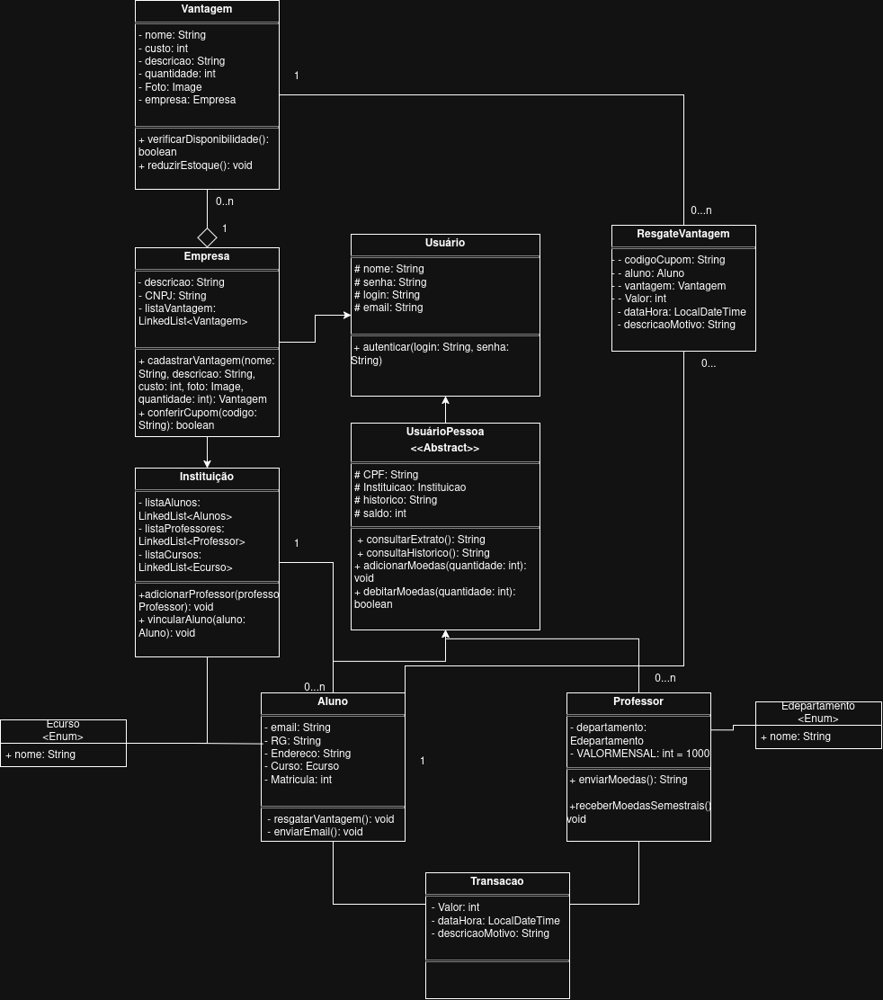
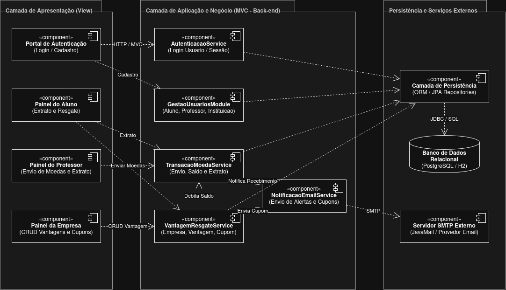

# TOKEN

O projeto TOKEN se consiste de um sistema completo que permite que alunos recebam pontos atribuidos pelos seus professores baseados em seus desempenhos acadêmicos e que esses pontos sejam trocados por vantagens cadastradas pela instituição ou suas empresas parceiras.

### Diagrama de Classes

### Diagrama de Componentes

### Diagrama de Casos de Uso

### Histórias de Usuário

US01 (Autenticação): Como usuário (aluno, professor ou empresa parceira), quero realizar login informando meu usuário e senha, para acessar as funcionalidades do meu perfil com segurança.   
PNG

US02 (CRUD de Aluno): Como aluno, quero gerenciar meu cadastro informando meus dados pessoais, instituição de ensino e curso, para ingressar e participar do sistema de mérito estudantil.   
PNG

US03 (CRUD de Empresa Parceira): Como empresa parceira, quero realizar e gerenciar meu cadastro no sistema, para poder ofertar produtos e descontos aos estudantes.   
PNG

US04 (Cadastro de Vantagens): Como empresa parceira, quero cadastrar vantagens informando nome, descrição, foto, estoque e custo em moedas, para disponibilizá-las no catálogo de trocas.   
PNG

US05 (Envio de Moedas): Como professor, quero enviar moedas do meu saldo acumulado (1.000 por semestre) a um aluno informando o motivo do reconhecimento, para premiar seu mérito e notificá-lo por e-mail.   
PNG

US06 (Consulta de Extrato): Como aluno ou professor, quero consultar meu saldo atual e o histórico de transações realizadas, para acompanhar minhas movimentações de moedas.   
PNG

US07 (Resgate de Vantagem): Como aluno, quero trocar minhas moedas por uma vantagem disponível e receber um cupom com código único por e-mail (enviado também à empresa parceira), para utilizá-lo presencialmente.